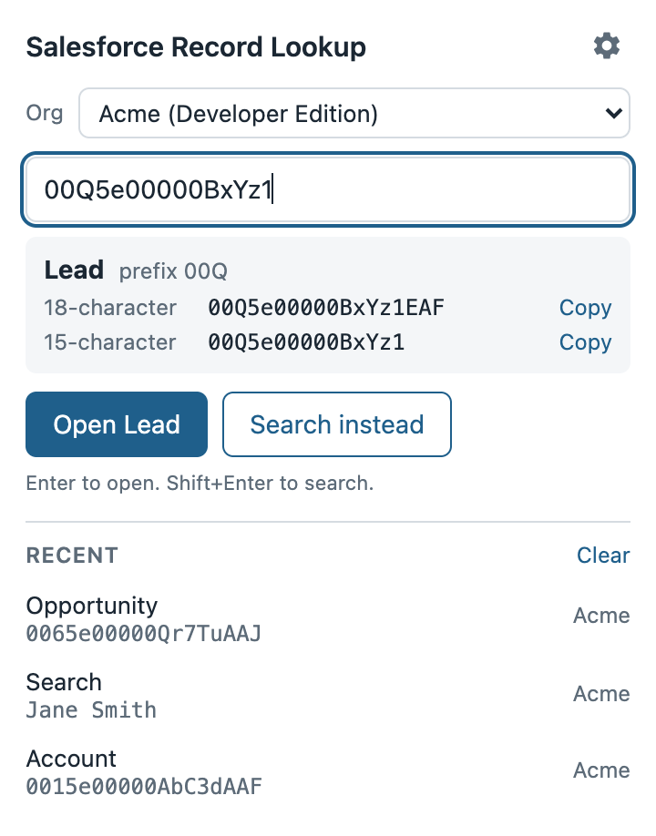

# Salesforce Record Lookup

A Chrome extension that opens any Salesforce record from its ID, or runs a Salesforce global search, in one step. It works in any org and keeps all data in your browser.



## The problem

Record IDs show up everywhere outside Salesforce: in emails, Slack threads, spreadsheet exports, error logs, and report rows. Getting from one of those IDs to the record usually means opening Salesforce, guessing which object it belongs to, and searching or editing a URL by hand.

This extension removes those steps. Paste the ID, a Salesforce link, or a whole sentence that contains an ID, and press Enter. If the text is not an ID, it runs a global search instead.

## Features

- **Open by ID.** Accepts 15- and 18-character record IDs, full Salesforce record URLs, or text with an ID somewhere in it.
- **Shows the object before opening.** Reads the ID's key prefix (for example, 001 is Account, 003 is Contact, 00Q is Lead, 006 is Opportunity) and shows the object type in the preview.
- **Converts between 15 and 18 characters.** Shows both forms with copy buttons. If an 18-character ID has had its letter case changed by a spreadsheet, the extension restores the correct case using the ID's built-in checksum.
- **Search fallback.** Anything that is not a valid ID runs a Salesforce global search. Shift+Enter searches even when the text contains an ID.
- **Works in any org.** Detects the org from the current tab, so lookups made from a sandbox stay in that sandbox. You can also save orgs (production, sandbox, Developer Edition, scratch orgs) and pick a default.
- **Lightning and Classic.** Each saved org can open records in Lightning, in Classic, or let Salesforce decide.
- **Keyboard shortcut.** Alt+Shift+S (Option+Shift+S on Mac) opens the popup. You can change it at `chrome://extensions/shortcuts`.
- **Address bar keyword.** Type `sf`, press Space, then type an ID or search term.
- **Recent lookups.** The last 10 lookups are listed in the popup for one-click reopening. You can turn this off or clear it.
- **New tab or current tab.** Choose where lookups open.

## Install

The extension is not published in the Chrome Web Store. To install it from source:

1. Download this repository (Code, then Download ZIP) and unzip it, or clone it with git.
2. In Chrome, go to `chrome://extensions`.
3. Turn on **Developer mode** in the top right corner.
4. Click **Load unpacked** and select the folder that contains `manifest.json`.
5. The settings page opens. Add your org by pasting any URL from it, or skip this and open the extension from a Salesforce tab.

Pin the extension from the puzzle-piece menu in the toolbar to keep it one click away.

## How to use it

| To do this | Do this |
| --- | --- |
| Open a record | Open the popup (click the icon or press Alt+Shift+S), paste an ID or link, press Enter |
| Search Salesforce | Type a name, email, or other term and press Enter |
| Search for text that looks like an ID | Press Shift+Enter, or click **Search instead** |
| Look up from the address bar | Type `sf`, press Space, type an ID or term, press Enter |
| Copy the other ID format | Paste an ID and click **Copy** next to the 15- or 18-character version |
| Switch orgs | Use the **Org** menu in the popup, or set a default in Settings |

## Privacy and permissions

Nothing leaves your browser.

- The extension makes no network requests of its own and includes no analytics or tracking.
- Settings and recent lookups are stored in `chrome.storage.local` on your computer. They are not synced to your Google account.
- It does not read Salesforce pages or data. It builds a link and opens it in a tab, exactly as if you had typed it.

It requests two permissions:

- `activeTab`: lets it read the address of the current tab, only at the moment you open the popup or use the `sf` keyword, so it can tell which org you are in.
- `storage`: saves your orgs, preferences, and recent lookups locally.

It does not request access to any websites, and it has no content scripts.

## How it works

- **ID validation.** A Salesforce ID is 15 case-sensitive characters, or 18 characters with a 3-character suffix that encodes which letters in the first 15 are uppercase. The extension computes and checks that suffix. Input must contain both letters and digits to count as an ID, so ordinary words and phone numbers go to search.
- **Object type.** The first three characters of an ID identify the object. The extension includes a table of common standard objects. Custom object prefixes, which start with "a", are labeled as custom objects.
- **Org detection.** The extension recognizes the standard Salesforce domain formats (`*.my.salesforce.com`, `*.lightning.force.com`, Setup and Visualforce domains, and their sandbox, Developer Edition, and scratch variants) and turns any of them into the org's My Domain address.
- **Links.** Records open at `/lightning/r/<id>/view` (Lightning) or `/<id>` (Classic, or Auto, which lets Salesforce choose). Searches open the Lightning or Classic search page.

## Limitations

- Lightning has no documented URL for global search. The extension uses the same URL format that Salesforce puts in the address bar after a search, which could change in a future Salesforce release. The Classic search option uses a stable URL.
- The object type table covers common standard objects. Other standard objects show as "Unrecognized object" but still open normally.

## Development

The ID, org, and lookup logic lives in `src/lib/` as plain JavaScript modules with no dependencies. Tests use the test runner built into Node.js (version 22 or later):

```
npm test
```

There is no build step. Chrome loads the files in this folder directly.

```
manifest.json         Extension manifest (Manifest V3)
icons/                Toolbar and store icons
src/background.js     Service worker: address bar keyword and first-run setup
src/lib/sfid.js       ID validation, 15/18 conversion, key prefixes, ID extraction
src/lib/orgs.js       Org domain detection and URL building
src/lib/lookup.js     Turns input into a destination and manages history
src/lib/browser.js    Chrome storage and tab helpers
src/popup/            Popup page
src/options/          Settings page
tests/                Unit tests
```

## Disclaimer

This project is not affiliated with, endorsed by, or sponsored by Salesforce, Inc. Salesforce is a trademark of Salesforce, Inc. and is used here only to describe what the extension works with.

## License

[MIT](LICENSE), copyright Grant Kovich.
